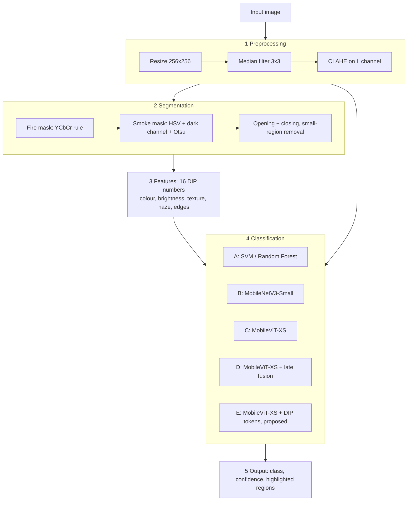

# Fire and smoke image classification with DIP-guided lightweight transformers

Classifies a single image as **fire**, **smoke** or **normal** for indoor and outdoor scenes (buildings, factories, streets, vehicles, wildland).
A classical digital image processing (DIP) pipeline — preprocessing, segmentation, hand-crafted features — is combined with a lightweight vision transformer (MobileViT-XS).

Course project for CSE 4462 Digital Image Processing Lab, University of Liberal Arts Bangladesh (ULAB).

## Pipeline



| Step | Method | Settings |
|---|---|---|
| Resize | area interpolation | 256 × 256 |
| Denoise | median filter | 3 × 3 |
| Contrast | CLAHE on L of LAB | clip 2.0, tile 8 |
| Fire mask | YCbCr rule (Celik & Demirel, 2009) | τ = 40 |
| Smoke mask | low saturation, V > 80, dark channel above Otsu threshold | patch 15 |
| Morphology | opening + closing, remove regions < 0.1 % | 5 × 5 ellipse |
| Features | colour 4, brightness 3, texture 4 (LBP, GLCM), haze 2, edges 3 (Sobel) | 16 total |

Preprocessing quality is reported as PSNR and SSIM between each step's input and output.

## Models

| ID | Model | Input |
|---|---|---|
| A | SVM (RBF) and Random Forest | 16 DIP features |
| B | MobileNetV3-Small | image |
| C | MobileViT-XS | image |
| D | MobileViT-XS, features concatenated before the classifier | image + 16 features |
| **E** | **MobileViT-XS, features injected as tokens into the transformer blocks (proposed)** | image + 16 features |

Shared training settings: 256 px, batch 32, AdamW (lr 5e-4, weight decay 0.05), cosine schedule, 15 epochs, label smoothing 0.1, class-weighted loss, mixed precision, seed 42.

## Data

| Role | Dataset |
|---|---|
| Train / validation / in-domain test | [D-Fire](https://github.com/gaiasd/DFireDataset) + FireAndSmoke (Roboflow, parts 1–2) |
| External test (unseen source) | [DeepQuestAI Fire-Smoke-Dataset](https://github.com/DeepQuestAI/Fire-Smoke-Dataset) |

- Labels from YOLO boxes: any fire box → fire; smoke boxes only → smoke; no box or "other" only → normal.
- Exact duplicates (MD5) removed everywhere; near-duplicates (pHash distance ≤ 4) removed across splits.
- Look-alike test set: normal images manually typed as sunset/sunrise, lamp/streetlight, vehicle light, reflection/glow, cloud/fog/haze.
- Raw images are not included in this repository; download them from the sources above into `data/raw/`. The split manifest is in `data/manifest/`.

## Evaluation

All models are evaluated on the same three test sets: in-domain (`test_in`), external (`test_ext`) and look-alikes (`test_lookalike`).
Metrics: accuracy and macro-F1 with 95 % bootstrap intervals, per-class precision/recall/F1, confusion matrix, fire recall, false-alarm rate (overall and per look-alike type), and inference speed (FPS).

## Results

| Experiment | Description | Status |
|---|---|---|
| E00 | Dataset manifest, duplicate removal, splits | done |
| E01 | Look-alike set labelled and frozen | done |
| E02 | Preprocessing analysis (PSNR/SSIM, denoising and contrast comparison) | done |
| E03 | Segmentation masks and box-overlap check | in progress |
| E04 | 16 DIP features for all images | in progress |
| E05 | Model A: SVM / Random Forest | in progress |
| E06–E09 | Models B–E | planned |
| E10 | Final evaluation, speed, failure analysis | planned |
| E11 | Prediction tool for new images | planned |

Every number is read from the saved run folders in `outputs/`; the table is updated as experiments finish.

## Repository structure

```
├── run.py                  single entry point for all stages
├── configs/                YAML configs (base.yaml + one per experiment)
├── src/
│   ├── data/               manifest, duplicates, look-alike labelling
│   ├── dip/                preprocessing, quality, segmentation, features, E02–E04
│   ├── classic/            model A (E05)
│   ├── eval/               metrics and evaluation figures
│   ├── viz/                figure style and image grids
│   └── common/             config loading, run folders, parallel processing, checks
├── data/manifest/          split manifest and look-alike types
├── outputs/                one folder per run: config, metadata, log, results, tables, figures
├── docs/                   pipeline explanation
└── requirements.txt
```

Each run folder contains `config.resolved.yaml`, `meta.json` (library versions, code and data hashes), a log, `results.json`, `tables/` and `figures/` (PDF, PNG and the CSV behind each figure). `outputs/LEDGER.md` lists every run.

## Reproduce

Install the CUDA build of PyTorch from [pytorch.org](https://pytorch.org/get-started/locally/) first, then:

```bash
python -m venv .venv
.venv\Scripts\activate
pip install -r requirements.txt
copy .env.example .env

python run.py check
python run.py manifest
python run.py lookalike-freeze
python run.py e02
python run.py e03
python run.py e04
python run.py e05
python run.py status
```

Add `--smoke` to any experiment for a quick test on a few images. Stages are resumable and never overwrite earlier runs.

## License

Code: MIT. Datasets keep their original licenses.
