# Fire and Smoke Detection with Adaptive DIP Preprocessing and MobileViT-XS

**Course:** CSE 4462 Digital Image Processing Lab, Open-Ended Lab (ULAB)
**Author:** Mahdia Hossain
**Final model:** CA = adaptive DIP preprocessing + MobileViT-XS trained with noise

> **In one sentence:** our system looks at one photo and says **fire**, **smoke** or **normal**. It cleans the photo with DIP filters **only when the photo is noisy**, so it stays reliable on bad cameras.

All numbers in this report come from the saved result files in `outputs/` (one training run per model, seed 42). The run folders are listed in `outputs/LEDGER.md`.

---

## Contents

1. [The problem](#1-the-problem)
2. [Key words explained](#2-key-words-explained)
3. [The dataset](#3-the-dataset)
4. [The final pipeline](#4-the-final-pipeline)
5. [Experiments, step by step](#5-experiments-step-by-step)
6. [All models compared](#6-all-models-compared)
7. [Robustness: damaged photos](#7-robustness-damaged-photos)
8. [Why we chose CA](#8-why-we-chose-ca)
9. [The firesmoke package](#9-the-firesmoke-package)
10. [Limitations](#10-limitations)
11. [Future work](#11-future-work)
12. [How to reproduce](#12-how-to-reproduce)
13. [References](#13-references)

---

## 1. The problem

Fires cause great damage when they are found late. Cameras are already everywhere, so a program that checks camera pictures could raise an early alarm.

The task has three answers: **fire**, **smoke** or **normal**.

It is hard for three reasons:

- **Look-alikes.** Sunsets, lamps and car lights look like fire. Fog and steam look like smoke.
- **Bad cameras.** Real CCTV photos are often noisy, dark, blurry or heavily compressed.
- **New places.** A model must work on photos from sources it never saw in training.

**Our contribution:** an *adaptive* DIP step. It measures the noise in each photo and filters only the noisy ones. Combined with a small transformer, this gave the best validation score of all 16 classifiers we trained, the fewest false alarms on look-alikes, and strong results on damaged photos.

---

## 2. Key words explained

| Word | Simple meaning |
|---|---|
| **DIP** | Digital Image Processing: changing a picture with maths, for example removing noise. |
| **Noise** | Random wrong pixels. **Gaussian noise** looks like grain. **Salt-and-pepper noise** looks like white and black dots. |
| **Median filter** | Replaces each pixel with the middle value of its neighbours. It removes dots and keeps edges sharp. |
| **CLAHE** | A contrast method that works on small tiles of the picture. It shows hidden detail without over-brightening. |
| **L channel (LAB)** | The lightness part of a colour picture. Changing only L keeps the colours (like the fire colour) the same. |
| **Immerkær noise estimate (σ)** | One small 3 × 3 filter that measures how noisy a photo is. Bigger σ means more noise. |
| **PSNR / SSIM** | Two scores that say how similar two pictures are. Higher means more similar. |
| **MobileViT-XS** | A small, fast "vision transformer", a deep-learning model for pictures. |
| **Macro-F1** | The average F1 score of the three classes. 1.0 is perfect. |
| **False alarm** | The model says fire or smoke when the photo is normal. |
| **Validation set** | Photos used to choose the best model. Test photos are never used for choosing. |

---

## 3. The dataset

We joined three public datasets and cleaned them carefully.

| Step | Number of photos |
|---|---|
| FireAndSmoke | 27,294 |
| D-Fire | 21,527 |
| DeepQuestAI (kept as a separate test set) | 3,000 |
| Exact copies removed | 157 |
| Near-copies removed | 9,875 |
| Train/val photos that copied a test photo, removed | 8,119 |
| **Final clean dataset** | **41,789** |

**Why we removed copies:** if the same photo is in training and in testing, the model "sees the exam answers", and the scores look better than they really are.

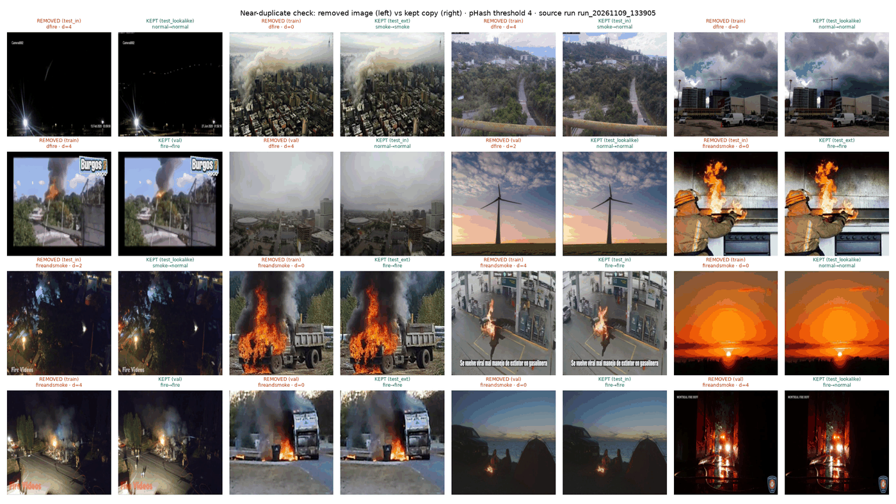
*Figure 1. Examples of near-copy pairs found by the duplicate check. One photo of each pair was removed.*

**The look-alike set.** We hand-checked 451 normal photos that look like fire or smoke: sunset (88), lamp (52), vehicle light (185), glow (51) and fog (75). 19 photos were rejected because they really showed fire or smoke.

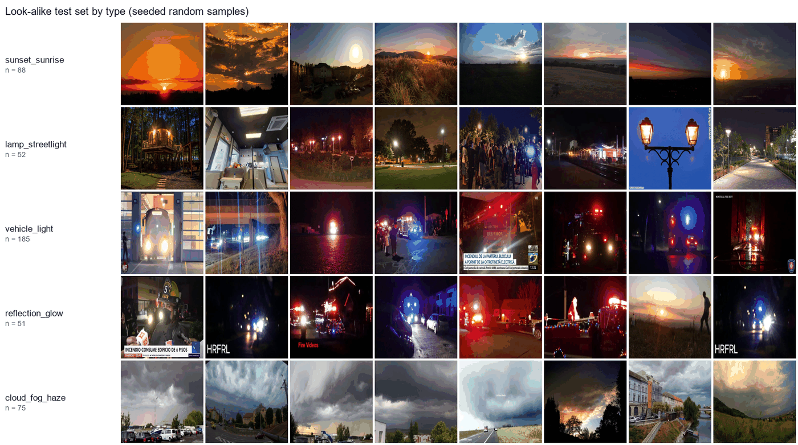
*Figure 2. Examples of each look-alike type. A good model must call all of these "normal".*

**Three test groups:**
- **Test in-domain:** new photos from the same sources as training.
- **DeepQuestAI:** photos from a completely different source. This is the fairest test.
- **Look-alikes:** the 451 tricky normal photos.

---

## 4. The final pipeline

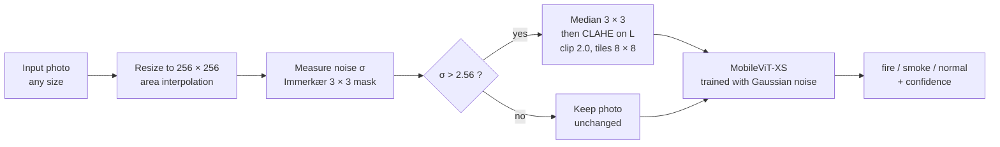

**Step by step:**

1. **Resize** the photo to 256 × 256 with area interpolation. Area interpolation averages pixels, so it also removes a little noise.
2. **Measure the noise σ** with Immerkær's mask:

   ```
   M = [[ 1, -2,  1],
        [-2,  4, -2],
        [ 1, -2,  1]]
   σ = sqrt(π/2) × mean(|I * M|) / 6
   ```
   The mask cancels smooth areas and straight edges, so what is left is mostly noise.
3. **Decide.** If σ > 2.56, the photo is called noisy. This threshold was chosen on validation photos (section 5, E03c).
4. **Filter only if noisy:** median 3 × 3 (removes dots), then CLAHE on the L channel (restores contrast and keeps colours).
5. **Classify** with MobileViT-XS. During training, half the photos got extra Gaussian noise (σ 5–25), so the model learns to ignore leftover noise.

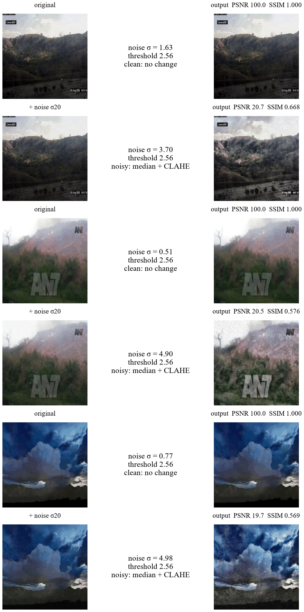
*Figure 3. The adaptive rule in action. Clean photos (σ below 2.56) pass unchanged. The same photos with added noise (σ above 2.56) get median + CLAHE.*

---

## 5. Experiments, step by step

Each experiment answers one question. For each one: **what we did → what we found → what we decided.**

### E02: How much do the filters change a photo?

**What we did.** We applied each preprocessing step to 1,300 photos and measured the change with PSNR and SSIM.

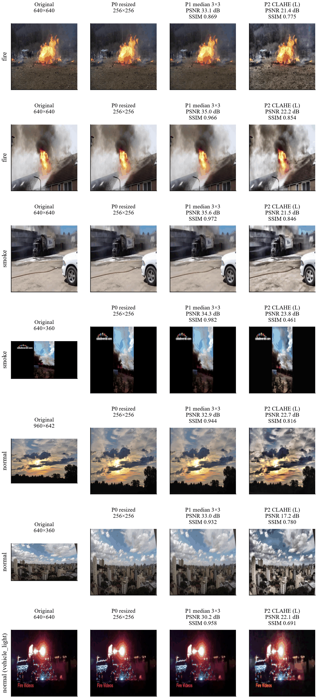
*Figure 4. Each step of preprocessing on example photos: original → resized → median → CLAHE on L.*

| Step | PSNR vs input (dB) | SSIM vs input |
|---|---|---|
| Median 3 × 3 | 32.32 | 0.925 |
| CLAHE on L | 21.07 | 0.799 |
| Both together | 20.83 | 0.786 |

**Comparing filters.** We added noise on purpose and measured how well each filter restored the photo.

| Noise added | Median | Gaussian | Bilateral |
|---|---|---|---|
| Salt-and-pepper (PSNR / SSIM) | **32.15 / 0.923** | 27.87 / 0.750 | 21.67 / 0.622 |
| Gaussian noise (PSNR / SSIM) | 29.97 / 0.819 | 31.10 / 0.848 | **34.56 / 0.894** |

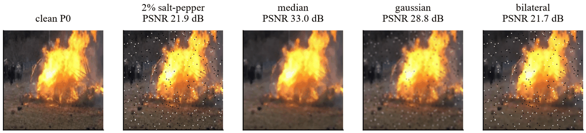
*Figure 5. Median, Gaussian and bilateral filters compared on a noisy photo.*

**Comparing contrast methods.** Colour shift (lower is better): histogram equalisation on RGB 18.4, on L 1.28, **CLAHE on L 0.32**.

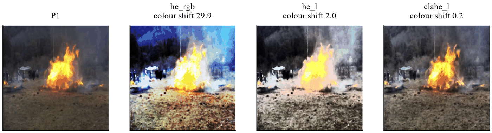
*Figure 6. Histogram equalisation on RGB changes colours a lot. CLAHE on L keeps the fire colour correct.*

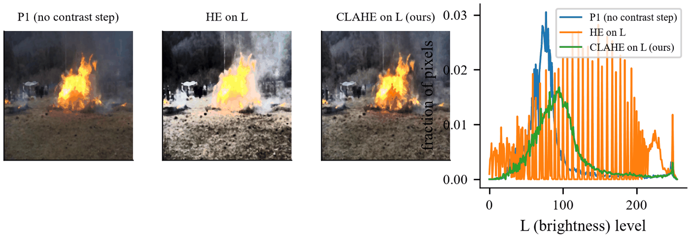
*Figure 7. The brightness histogram spreads out after CLAHE. Entropy rose from 7.05 to 7.33 bits, and RMS contrast from 53.8 to 56.2.*

**Decision.** Keep **median 3 × 3** (best for dot noise, keeps edges) and **CLAHE on L** (best contrast without colour change).

---

### E03 and E03b: Can colour rules find fire and smoke?

**What we did.**
- **Fire mask:** the YCbCr rule of Çelik & Demirel (fire pixels are bright and red, for example Y > Cb, Cr > Cb and |Cb − Cr| ≥ τ).
- **Smoke mask:** HSV rule (S < 70, V > 80) plus the dark channel above an Otsu threshold.
- **Morphology:** opening and closing with a 5 × 5 ellipse, then removing regions smaller than 0.1% of the image.

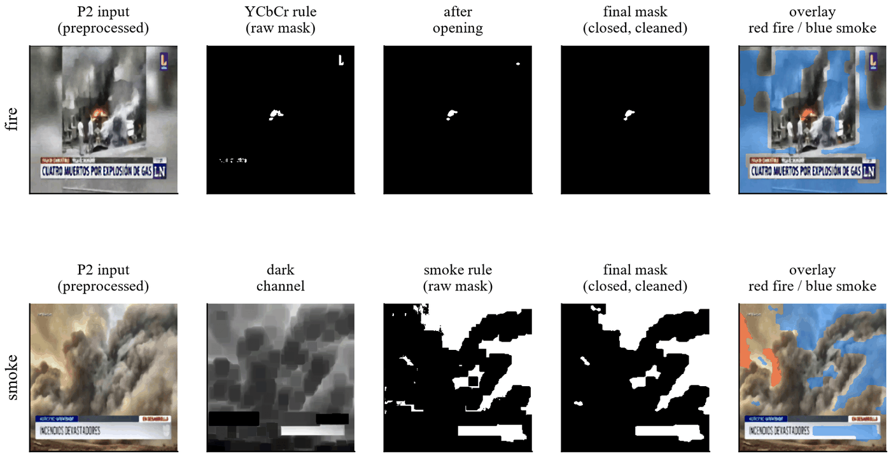
*Figure 8. Segmentation step by step. Top: fire (YCbCr rule → opening → closing → overlay). Bottom: smoke (dark channel → smoke rule → cleaned mask → overlay).*

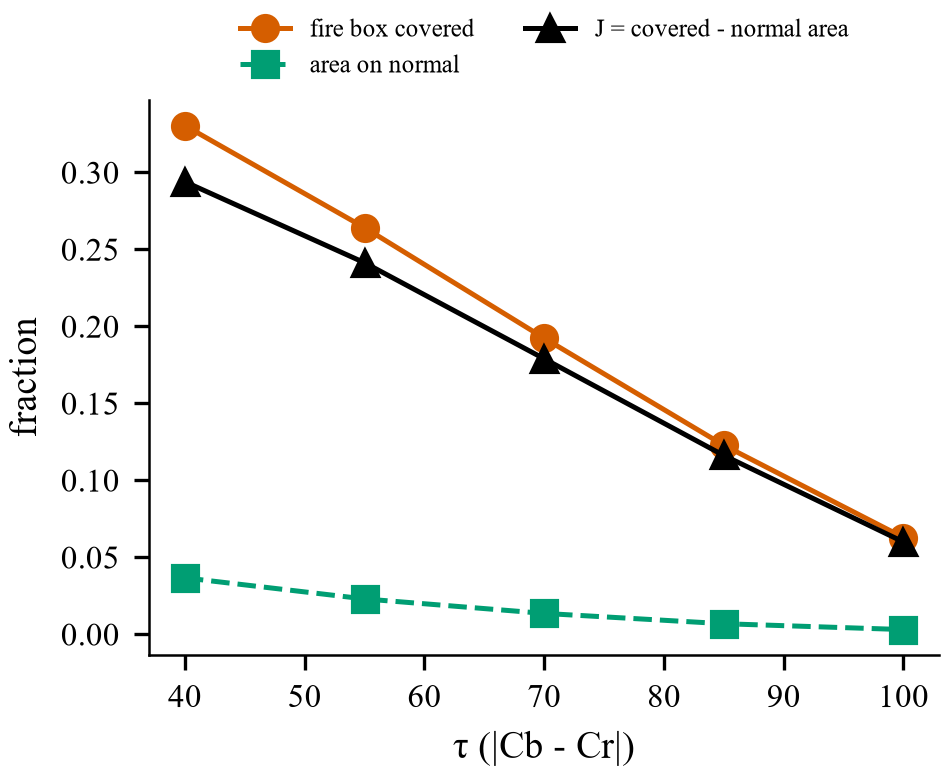
*Figure 9. Choosing the fire threshold τ on validation photos. τ = 40 was best.*

| Mask | Covers the real fire/smoke box | Area marked on normal photos | Score (J) |
|---|---|---|---|
| Fire (τ = 40) | 33% | 3.65% | 0.294 |
| Smoke | 33.7% | **18.9%** | 0.147 |

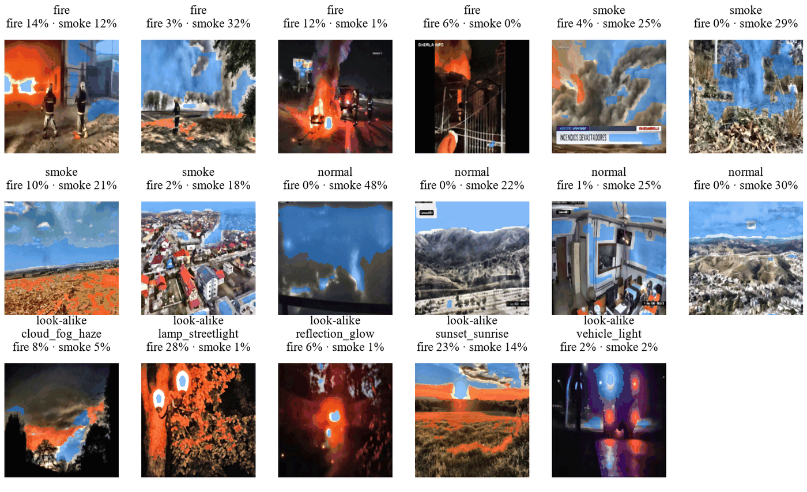
*Figure 10. More mask examples. The smoke mask often also marks grey sky, roads and walls.*

**Decision.** The fire mask is useful. The smoke mask is weak, because many normal things are grey like smoke. We used the masks only as **features and as a visual explanation**, not as the final answer.

---

### E04: 16 hand-made DIP features

**What we did.** We turned every photo into 16 numbers: for example redness, fire area, fire-mask edges, smoke area and dark-channel haze. This took about 22 ms per photo, for 41,564 photos.

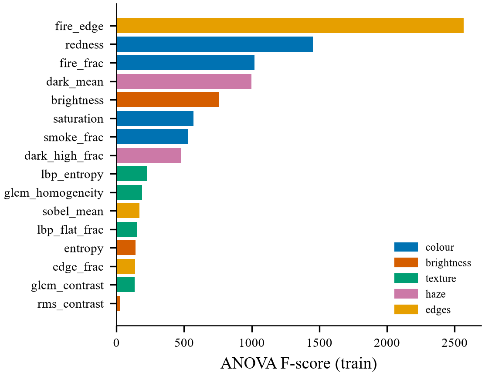
*Figure 11. The strongest single features (ANOVA F-score): fire edges (2568), redness (1452), fire area (1021), dark-channel mean (999).*

**Decision.** Use these features in models A, D, E, EM and EMD.

---

### Model A: classic machine learning (SVM and Random Forest)

**What we did.** We gave only the 16 numbers to an SVM and a Random Forest. No deep learning.

**What we found.** Val 0.696 (RF) and 0.642 (SVM). On DeepQuestAI only 0.508 and 0.524, with 81.6% and 76.8% false alarms.

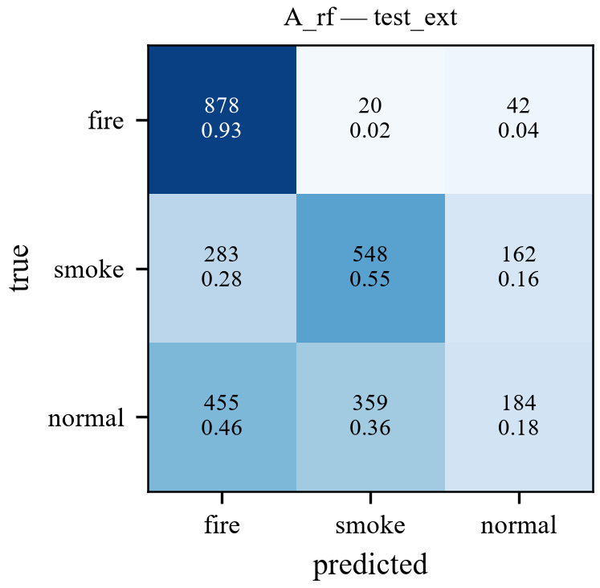
*Figure 12. Model A (Random Forest) on DeepQuestAI. Most normal photos are wrongly called fire or smoke.*

**Decision.** Discarded. 16 numbers cannot describe a photo well enough. It is our **baseline**: it shows why deep learning is needed.

---

### Model B: a small CNN (MobileNetV3-Small)

**What we found.** Val 0.886, DeepQuestAI 0.856, 22.2% false alarms.

**Decision.** Discarded. Every MobileViT model beat it. This is why we chose a transformer.

---

### Model C: always filter, then MobileViT-XS

**What we did.** Every photo got median + CLAHE, then went to MobileViT-XS.

**What we found.** Val 0.908, DeepQuestAI 0.883. In a first robustness test, its score fell to **0.546** with strong noise (σ 25).

**Decision.** Discarded. It filters clean photos for no reason, and it breaks under noise. **This finding started the adaptive idea.**

---

### Models D, E, EM, CM, EMD: adding DIP hints to the transformer

| Model | What it adds | Val | DeepQuestAI | Look-alike false alarms |
|---|---|---|---|---|
| D | 16 features joined at the end | 0.913 | 0.898 | 2.7% |
| E | 16 features as "hint tokens" | 0.913 | 0.878 | 3.6% |
| EM | hint tokens + learned maps | 0.916 | 0.888 | 3.3% |
| CM | learned maps only | 0.913 | 0.875 | 4.2% |
| EMD | hint tokens + maps from DIP masks | 0.910 | 0.883 | 2.7% |

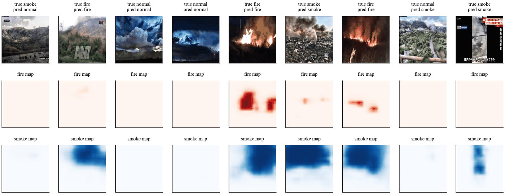
*Figure 13. Maps learned by model EM, showing where the model looks.*

**Hint ablation: do the models really use the hints?** We switched off one group of features at test time.

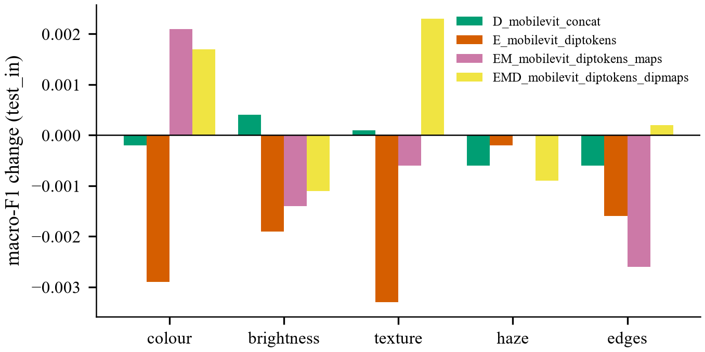
*Figure 14. Switching off any feature group changes D and EM by less than 0.5 points. Only E loses a little on DeepQuestAI (−0.013 for texture, −0.011 for edges).*

**Decision.** All discarded. They are more complex but not better, and the transformer barely uses the hints. So we stopped adding hints and focused on **cleaning the photo** instead.

---

### Model CR: raw photos, no DIP at all

**What we did.** MobileViT-XS on raw photos, to test honestly whether DIP helps.

**What we found.** Very good on clean photos: val 0.916, best in-domain test (0.902), DeepQuestAI 0.900. But under noise it **collapsed**: 0.40 at σ 25, and 0.43 with 5% salt-and-pepper. Its fire recall at σ 25 was only 0.38.

**Decision.** Discarded. This proved that **DIP is needed for robustness**.

---

### E03c: When is a photo "noisy"?

**What we did.** We measured σ on clean and noisy validation photos and picked the threshold that separates them best.

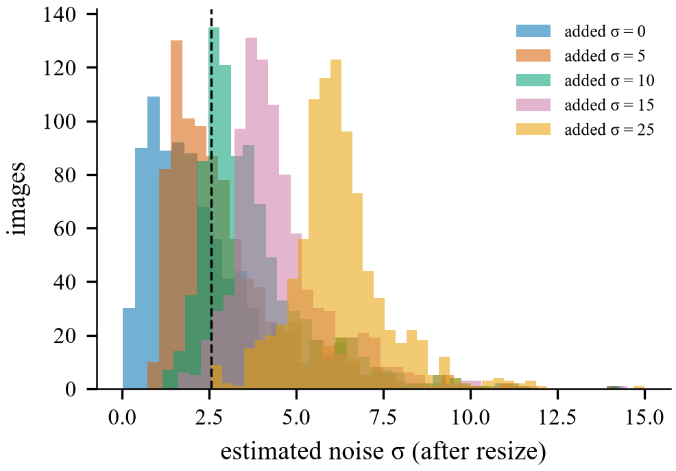
*Figure 15. Noise σ for clean and noisy photos. The chosen threshold is σ = 2.56 (balanced accuracy 0.784).*

**What we found.** σ > 2.56 catches 97% of photos with noise σ 15 and 100% with σ 25. It also flags 36% of the original photos, because many camera photos are already a bit noisy.

---

### Model CA: the final model

**What we did.** Adaptive filter (only when σ > 2.56) + Gaussian-noise training.

**What we found.**
- **Best validation macro-F1 of all models: 0.917**
- DeepQuestAI 0.900, test in-domain 0.895
- **Fewest look-alike false alarms: 2.2%**
- Smoke recall 0.815, fire recall 0.955 (test in-domain)
- Stays at 0.81 or higher under every kind of damage (section 7)

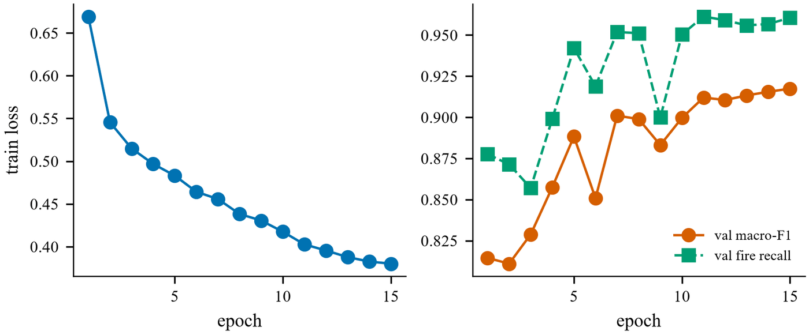
*Figure 16. CA training curve. The best epoch was 15, chosen by validation score.*

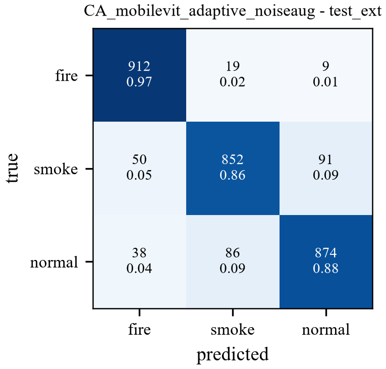
*Figure 17. CA on DeepQuestAI (photos from a new source).*

**Decision.** **Chosen as the final model.**

---

### Models CRN and CN: which part of CA does the work?

| Model | Filter | Noise training | Val | Salt-and-pepper 5% |
|---|---|---|---|---|
| CRN | never | yes | 0.909 | **0.44** |
| CN | always | yes | **0.899** | 0.788 |
| **CA** | **only when noisy** | **yes** | **0.917** | **0.820** |

**Decision.** Both discarded. CRN has no median filter, so dots break it. CN filters clean photos too, so its clean score drops. **CA needs both parts.**

---

### E03d and Model CA2: a brightness rule for dark photos

**What we did.** We found a "dark photo" threshold and brightened dark photos.

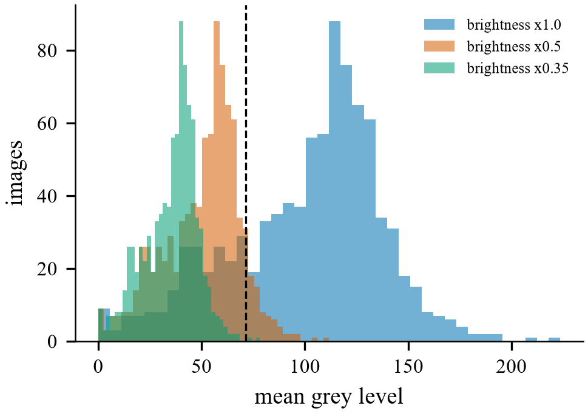
*Figure 18. Mean brightness of normal and darkened photos. The chosen threshold is 71.4 (balanced accuracy 0.87).*

**What we found.** It flagged 21.9% of ordinary photos as dark. CA2 scored val 0.908, lower than CA.

**Decision.** Discarded. The CA2 run folder was deleted by mistake, so its DeepQuestAI and look-alike scores are missing. Its val and test scores come from the ledger.

---

### E12: Which filter is best for which noise?

**What we did.** We added noise to 150 photos on purpose and compared 16 filters with the clean original.

> **A mistake we corrected.** The first version (v1) added the noise *after* resizing. Real cameras add noise *before*. We fixed this in v2 and report both.

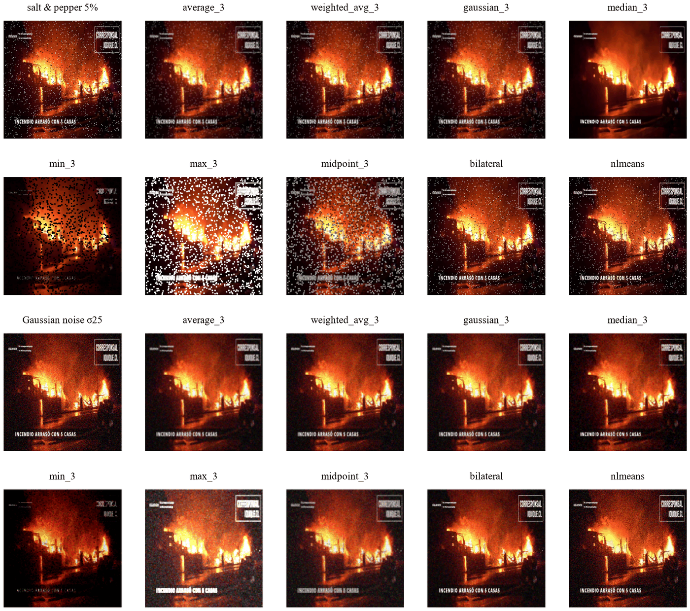
*Figure 19. The same noisy photo restored by different filters.*

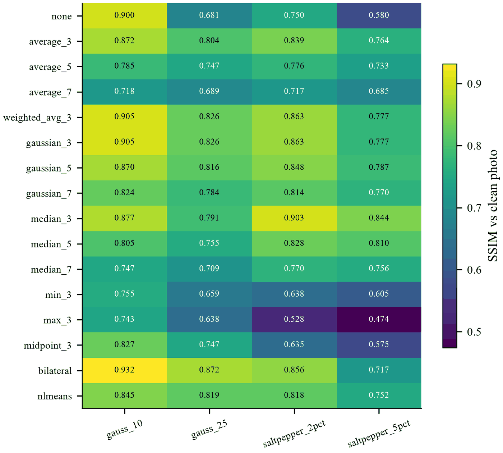
*Figure 20. SSIM of each filter for each noise type (v2).*

| Noise (v2) | Best filter | SSIM |
|---|---|---|
| Gaussian σ 10 | Bilateral | 0.932 |
| Gaussian σ 25 | Bilateral | 0.872 |
| Salt-and-pepper 2% | Median 3 × 3 | 0.903 |
| Salt-and-pepper 5% | Median 3 × 3 | 0.844 |

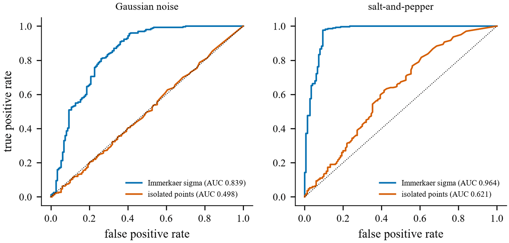
*Figure 21. How well each detector finds noise (v2). The σ estimate works for both types (AUC 0.839 Gaussian, 0.964 salt-and-pepper). Isolated point detection works poorly after resizing (AUC 0.62), because resizing shrinks the dots.*

---

### Models CA3 v1 and v2: "double adaptive"

**What we did.** First detect the noise type, then pick its best filter: median for dots, bilateral for Gaussian noise.

| Model | Val | DeepQuestAI | Gaussian σ 25 |
|---|---|---|---|
| CA3 v1 (made with the E12 mistake) | 0.909 | 0.904 | 0.805 |
| CA3 v2 (corrected) | 0.914 | 0.891 | 0.763 |
| **CA** | **0.917** | **0.900** | **0.815** |

**Decision.** Both discarded, because both have a lower val score than CA. **Lesson:** the filter that makes the prettiest image (best SSIM) is not always the best filter for the classifier.

---

## 6. All models compared

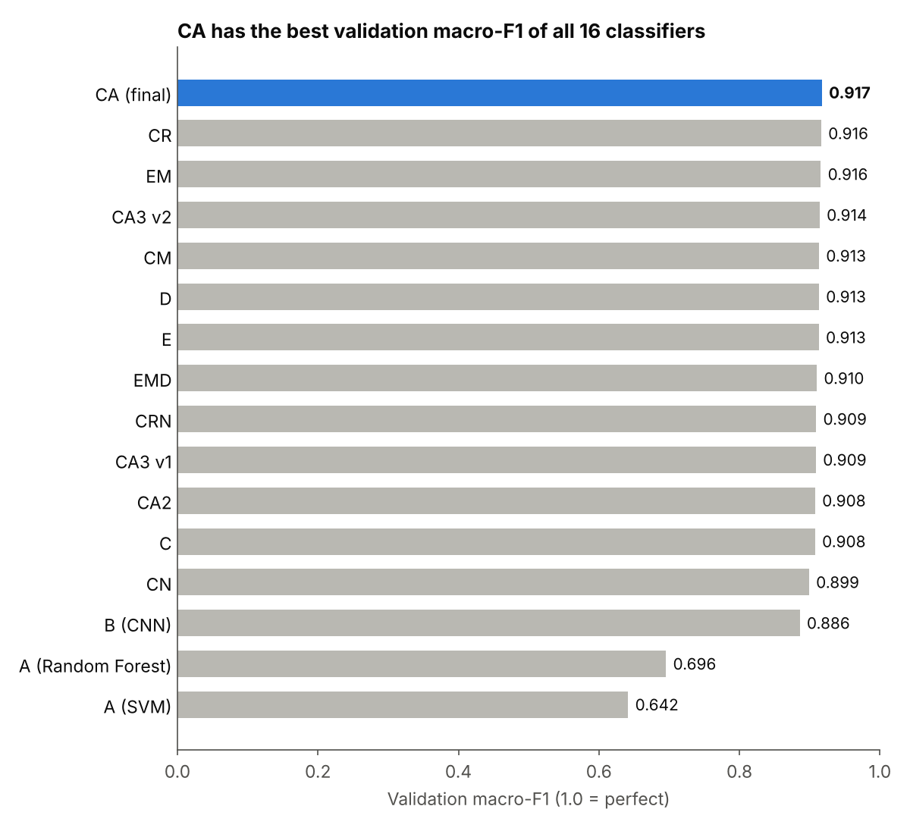
*Figure 22. Validation macro-F1 of all 16 classifiers. Only validation was used to pick the winner.*

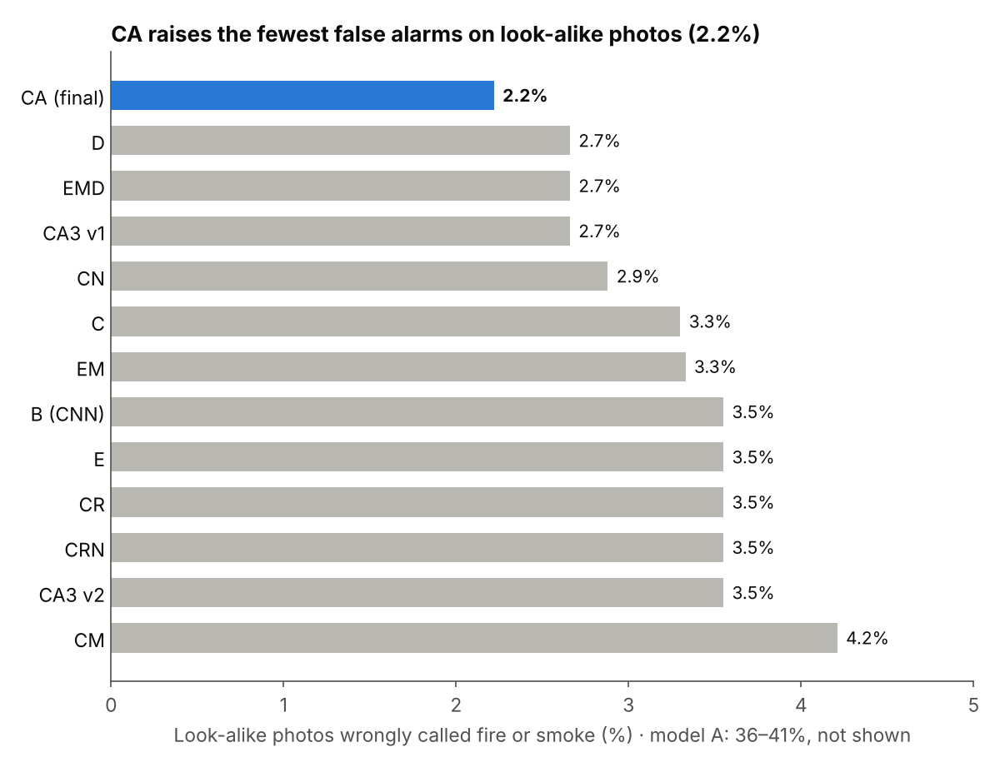
*Figure 23. Share of look-alike photos wrongly called fire or smoke.*

| Model | Idea | Val | Test in-domain | DeepQuestAI | False alarms, DeepQuestAI | False alarms, look-alikes |
|---|---|---|---|---|---|---|
| **CA (final)** | adaptive DIP + noise training | **0.917** | 0.895 | **0.900** | 12.4% | **2.2%** |
| CR | raw photos | 0.916 | **0.902** | 0.900 | 12.0% | 3.6% |
| EM | hint tokens + learned maps | 0.916 | 0.889 | 0.888 | 17.4% | 3.3% |
| CA3 v2 | filter per noise type | 0.914 | 0.891 | 0.891 | 15.7% | 3.6% |
| CM | learned maps | 0.913 | 0.894 | 0.875 | 16.5% | 4.2% |
| D | features at the end | 0.913 | 0.891 | 0.898 | **10.7%** | 2.7% |
| E | hint tokens | 0.913 | 0.895 | 0.878 | 18.7% | 3.6% |
| EMD | hint tokens + DIP-mask maps | 0.910 | 0.887 | 0.883 | 13.1% | 2.7% |
| CRN | raw + noise training | 0.909 | 0.891 | 0.897 | 13.2% | 3.6% |
| CA3 v1 | filter per noise type (v1) | 0.909 | 0.888 | 0.904 | 13.1% | 2.7% |
| CA2 | adaptive + brightness rule | 0.908 | 0.890 | not saved | not saved | not saved |
| C | always DIP | 0.908 | 0.890 | 0.883 | 15.5% | 3.3% |
| CN | always DIP + noise training | 0.899 | 0.887 | 0.887 | 16.8% | 2.9% |
| B | MobileNetV3 CNN | 0.886 | 0.878 | 0.856 | 22.2% | 3.6% |
| A (RF) | 16 features only | 0.696 | 0.711 | 0.508 | 81.6% | 40.8% |
| A (SVM) | 16 features only | 0.642 | 0.690 | 0.524 | 76.8% | 35.7% |

---

## 7. Robustness: damaged photos

We damaged the DeepQuestAI photos on purpose **before** the pipeline and measured macro-F1 again. Nothing was retrained.

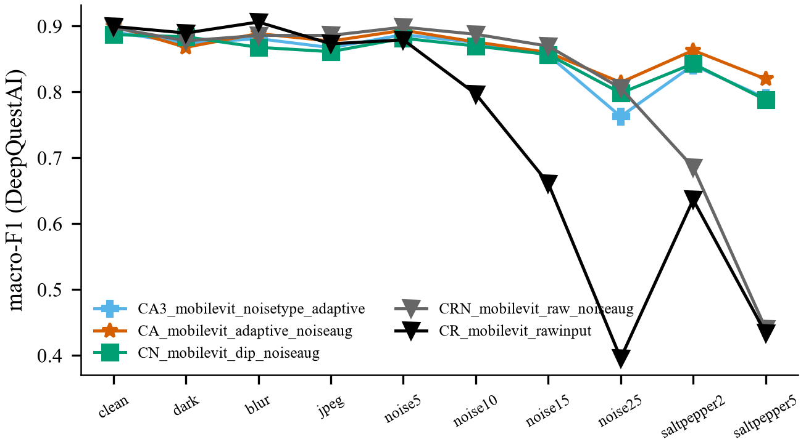
*Figure 24. Macro-F1 on DeepQuestAI under each kind of damage.*

| Model | clean | dark | blur | JPEG | σ 5 | σ 10 | σ 15 | σ 25 | S&P 2% | S&P 5% |
|---|---|---|---|---|---|---|---|---|---|---|
| **CA** | **0.900** | 0.868 | 0.889 | 0.877 | 0.894 | 0.876 | 0.860 | **0.815** | **0.863** | **0.820** |
| CA3 v2 | 0.891 | 0.874 | 0.881 | 0.867 | 0.887 | 0.875 | 0.856 | 0.763 | 0.841 | 0.791 |
| CN | 0.887 | 0.884 | 0.868 | 0.861 | 0.882 | 0.870 | 0.857 | 0.798 | 0.843 | 0.788 |
| CRN | 0.897 | 0.878 | 0.886 | 0.886 | 0.898 | 0.888 | 0.870 | 0.806 | 0.686 | 0.441 |
| CR | 0.900 | 0.890 | 0.906 | 0.873 | 0.879 | 0.797 | 0.661 | 0.396 | 0.636 | 0.434 |

**What this shows:**
- On clean, dark, blurred and JPEG photos, all models are close.
- **Without a median filter** (CR, CRN), salt-and-pepper noise breaks the model.
- **Without noise training** (CR), strong Gaussian noise breaks the model.
- **CA is the only model that stays at 0.81 or higher under every damage.** At σ 25, CA still finds 91% of fires, while CR finds only 38%.

---

## 8. Why we chose CA

1. **Fair choice:** it has the highest validation score (0.917). We chose it before looking at the test sets.
2. **Fewest look-alike false alarms** (2.2%).
3. **Most robust:** it stays strong under every kind of damage.
4. **Simple and explainable:** one small filter (Immerkær), one threshold, two classic filters.

**The DIP theory behind it:**
- The **median filter** is an order-statistic filter. A single wrong dot is never the middle value, so it is simply thrown away, and edges stay sharp.
- **Filtering only when needed** avoids removing real detail from clean photos.
- **CLAHE on L** improves local contrast with a clip limit, so noise is not over-amplified, and the colours stay unchanged.
- **Noise training** teaches the network to ignore the little noise the filter leaves behind. DIP and deep learning work best together.

---

## 9. The firesmoke package

We packed the final model into a small Python library, so anyone can use it like YOLO: install once, give it a photo, get an answer with every step shown.

### How we built it

| Part | What it does |
|---|---|
| `python run.py export` | Packs the weights, the thresholds (σ 2.56), the filter settings and the class names into **one file**, `release/firesmoke_CA.pt` (about 8 MB), plus `MODEL_CARD.md`. |
| `firesmoke/dip.py` | The DIP steps: resize, measure noise, filter if needed, make the masks. It is the **same code** as in training. |
| `firesmoke/detector.py` | The `FireSmokeDetector` class. Load the file once, then call `.predict(photo)`. |
| `firesmoke/cli.py` | The `firesmoke predict` command for the terminal. |
| `pyproject.toml` | Makes it installable with `pip install -e .` and creates the `firesmoke` command. |
| `colab_firesmoke.ipynb` | Runs everything in Google Colab, with a fresh photo folder and output folder each run. |

### How to use it

```bash
pip install -e .
firesmoke predict my_photos --weights release/firesmoke_CA.pt --steps --out outputs/e11_predict/demo
```

```python
from firesmoke import FireSmokeDetector

det = FireSmokeDetector("release/firesmoke_CA.pt")
r = det.predict("photo.jpg")
print(r.label, r.confidence)   # for example: smoke 0.80
print(r.sigma, r.decision)     # measured noise and whether the filter was used
print(r.explain())             # the reason in words
r.show_steps()                 # every intermediate image
r.save("outputs/one_photo")    # save everything
```

**What one result contains:** `label`, `confidence`, `probs`, `sigma`, `points_share`, `decision`, `filter`, `thresholds`, `model`, `steps`.

### Demo on new photos

> **TODO:** add the demo results table (photo, label, confidence, σ, filter) and 4 step images (one fire, one smoke, one fog, one sunset) from `outputs/e11_predict/demo_set`, once that run is done.

These demo photos come from the web and may already be in the training datasets. So the demo is a **qualitative example**, not a test score. The real scores are in sections 6 and 7.

---

## 10. Limitations

- **One training run per model** (seed 42). Differences smaller than about one point may be due to chance.
- **A mistake we corrected:** E12 v1 added noise after resizing. We fixed it (v2) and retrained CA3.
- **Best image quality ≠ best classifier:** the filter with the best SSIM did not give the best classifier.
- **Weak smoke mask:** it marks 18.9% of the area of normal photos.
- **False alarms on DeepQuestAI:** about 12% of normal photos are still called fire or smoke.
- **Dark photos:** no model improved clearly, and the brightness rule (CA2) did not help.
- **Lost results:** the CA2 run folder was deleted, so some of its scores are missing.
- **Single photos only:** no video, so no motion cues for smoke.

---

## 11. Future work

- Train every model with three or more seeds and use paired statistical tests.
- Extend to video and add motion features for smoke.
- Run the package on a small robot or edge camera.
- Improve the smoke mask with texture (for example, local binary patterns).
- Do a full literature check before submitting a paper.

---

## 12. How to reproduce

```bash
# 1. install
pip install -r requirements.txt
pip install -e .

# 2. train the final model (CA)
python src/deep/train.py --model CA

# 3. robustness probe
python src/deep/probe.py --mode robust

# 4. export the package file
python run.py export
```

Every run writes its config, logs, metrics, tables and figures into its own `outputs/<stage>/run_<date>_<time>/` folder, and adds a line to `outputs/LEDGER.md`.

---

## 13. References

1. J. Immerkær, "Fast noise variance estimation," *Computer Vision and Image Understanding*, 64(2), 300–302, 1996. https://doi.org/10.1006/cviu.1996.0060
2. S. Mehta and M. Rastegari, "MobileViT: Light-weight, general-purpose, and mobile-friendly vision transformer," *ICLR*, 2022. https://arxiv.org/abs/2110.02178
3. T. Çelik and H. Demirel, "Fire detection in video sequences using a generic color model," *Fire Safety Journal*, 44(2), 147–158, 2009. https://doi.org/10.1016/j.firesaf.2008.05.005
4. S. Dodge and L. Karam, "Understanding how image quality affects deep neural networks," *QoMEX*, 2016. https://arxiv.org/abs/1604.04004
5. *Remote Sensing*, 18, 01880, 2026. https://mdpi-res.com/d_attachment/remotesensing/remotesensing-18-01880/article_deploy/remotesensing-18-01880.pdf
6. D-Fire dataset. https://github.com/gaiasd/DFireDataset
7. DeepQuestAI Fire-Smoke dataset. https://github.com/DeepQuestAI/Fire-Smoke-Dataset
